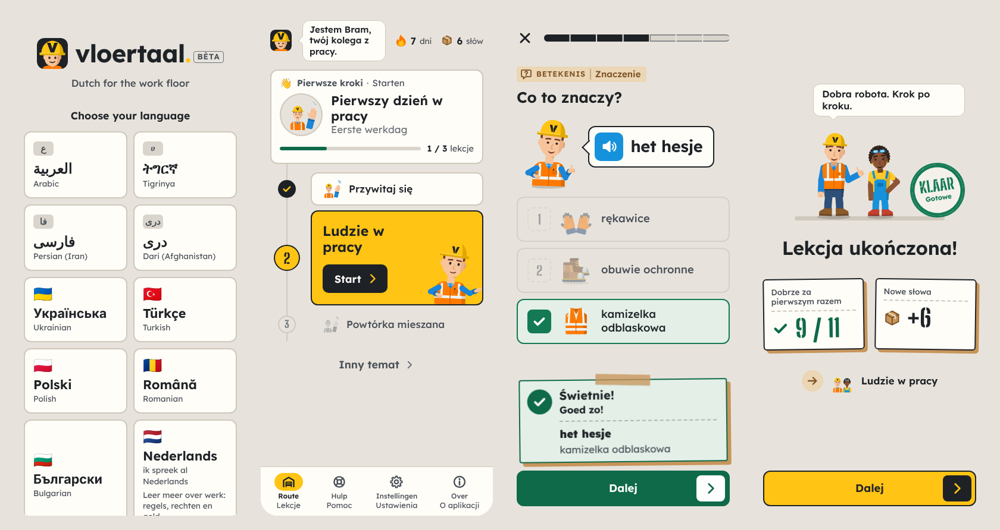
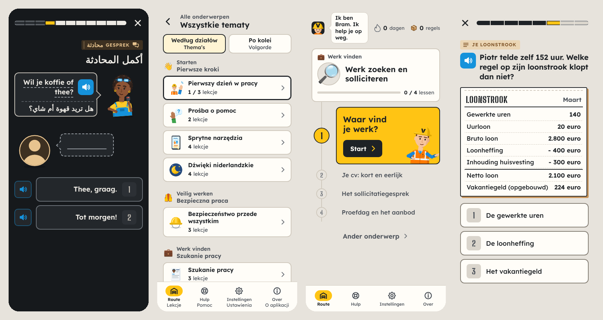

# 👷 Vloertaal <sup>bèta</sup>

**Nederlands voor op de werkvloer, met hulp in je eigen taal.**

Vloertaal is een gratis webapp voor mensen die in Nederland (gaan) werken, ook als lezen moeilijk
gaat. Geen account, geen reclame, geen verdienmodel. Live op **[vloertaal.nl](https://vloertaal.nl)**
(wat er nieuw is: [vloertaal.nl/nieuw](https://vloertaal.nl/nieuw)). Contact: hoi@vloertaal.nl.

De app is nog een **bètaversie**: experts en moedertaalsprekers kijken de inhoud na (zie onderaan).
Sinds 15 oktober 2026 loopt een pilot met leerlingen ([`docs/pilot.md`](docs/pilot.md)).




## Twee sporen

| Spoor | Voor wie | Wat |
|---|---|---|
| **Taal** | wie (bijna) geen Nederlands spreekt | Nederlands voor het werk, met uitleg in een hulptaal |
| **Werkregels** (bèta) | wie al Nederlands spreekt (kies "Nederlands") | de geschreven en ongeschreven regels op het werk: loon, contract, ziek zijn, rechten |

Hulptalen in het spoor Taal:

| Hulptaal | Voor wie |
|---|---|
| العربية Arabisch (Modern Standaard) | Syrië, Irak, Marokko: MSA zodat iedereen het begrijpt |
| ትግርኛ Tigrinya | Eritrea: vrijwel geen lesmateriaal beschikbaar |
| فارسی Perzisch | Iran |
| دری Dari | Afghanistan: eigen variant, niet Iraans Perzisch |
| Українська Oekraïens | ontheemden met tijdelijke bescherming |
| Türkçe Turks | bestaande gemeenschap en nieuwe instroom |
| Polski Pools, Română Roemeens, Български Bulgaars | arbeidsmigranten |
| English only | iedereen met een andere taal |

## Wat zit erin

**Spoor Taal**
- **31 onderwerpen, 99 lessen** (408 woorden, 204 zinnen, 129 gesprekjes), in **8 thema's**:
  Starten, Veilig werken, Werk vinden, Je baan, Samenwerken, Je rechten, Leven in Nederland en
  Jouw sector (Logistiek, Bouw, Productie, Zorg, Horeca, Schoonmaak).
- Ook: **Klanken** (woordparen als man/maan, pak/bak), **Uitdrukkingen en gezegden** (daarna komt
  in latere lessen een passende uitdrukking terug), **In de winkel** en **Rekenen**.
- **Oefeningen**: nieuw woord met plaatje en uitspraak, betekenis kiezen, Nederlands woord kiezen,
  luisteren, paren verbinden, zin bouwen (later op het gehoor), typen, gesprekken en spreken
  (opnemen en vergelijken). Latere onderwerpen worden stap voor stap moeilijker.
- **Werkvloer-tips** (65): hoe het hier gaat op het werk, en je rechten, met een verwijzing naar
  vakbond, Juridisch Loket of FairWork bij uitbuiting.

**Spoor Werkregels** (bèta, alleen Nederlands)
- **23 onderwerpen, 66 lessen**: korte verhalen, regelkaarten, waar-of-niet-waar, "wat doe je?",
  een getekende loonstrook, rekenen met kaartjes. Per les een "Onthoud"-zin.
- Hulp-pagina "Wie bel je?" met de juiste instanties.

**Voor beide**
- **Lespad**: de app kiest het volgende onderwerp, passend bij je sector. Bij **Alle onderwerpen**
  kies je zelf: op thema of op volgorde.
- **Herhaal vandaag**: elke dag een korte herhaling van wat je het minst goed kent (gespreid
  herhalen).
- **Certificaat** per afgerond onderwerp, een **zakkaart** met de belangrijkste zinnen, en bij 3, 7,
  14 en 30 dagen op rij een kort **"Wist je dat?"**.
- **Bram**, de collega met de V op zijn helm: zegt rustig één zin, zonder schuldgevoel en zonder
  meldingen.
- **Hulp in je eigen taal**, met mannelijke en vrouwelijke vormen en echte meervouden.
- **Toegankelijk**:
  - hooguit 3 dingen om op te tikken per scherm (gecontroleerd met `scripts/max3/count.cjs`);
  - één vraag per pagina bij de start;
  - alles kan worden voorgelezen, ook de hulptaal;
  - werkt rechts-naar-links, in Tigrinya-schrift, met grote letters, donker en zonder geluid.
- **Echte stemmen** (ElevenLabs, 1389 opnames); zonder opname leest de telefoonstem voor.
- **Privacy**:
  - geen account en geen cookies; voortgang alleen op het toestel;
  - alleen een anonieme telling (GoatCounter): app geopend, les gestart, gestopt en afgerond, per
    hulptaal, per sector en per les, elk apart. Respecteert Do Not Track, uit te zetten;
  - de microfoon slaat niets op.
- **Offline**: met "Lessen op deze telefoon" staat het huidige onderwerp op de telefoon (PWA).
  Een app op het beginscherm haalt zelf een nieuwe versie op als hij weer in beeld komt. Bij
  **Over** staat welke versie je hebt.
- **Voor begeleiders**: `#begeleiders` heeft links per onderwerp en feiten over waarom Nederlands
  leren helpt, met bronnen.

## Toegang

Je krijgt een code van een docent, coach of werkgever. Zonder code kun je één proefles doen.

| Niveau | Wat is open |
|---|---|
| **Volledig** | alles (pilot, experts, kandidaten) |
| **Sneak preview** | per thema de eerste les (bij Jouw sector van elke sector), plus Herhaal vandaag |
| **Proef** | alleen het eerste onderwerp |

- In de code staan **alleen SHA-256-hashes** van de codes (`src/lib/access.ts`), nooit de codes
  zelf. Een code geef je per bericht, niet openbaar.
- De app maakt een code eerst gelijk: kleine letters, zonder spaties, streepjes en punten, en met
  Arabische of Perzische cijfers als 0–9. Een nieuwe code toevoegen:

  ```bash
  printf '%s' 'voorbeeldcode12' | sha256sum   # de gelijkgemaakte vorm van "Voorbeeld-Code 12"
  ```

  Zet de hash met het niveau in `PASSWORD_HASHES` en pas `tests/access.test.ts` aan.
- Wie een code al invulde, houdt het niveau van toen: dat staat op de telefoon.
- **Melden**: in elke les staat rechtsboven een knop **Melden** met een vlaggetje (de eerste keer
  met een korte uitleg in het Nederlands, voor testers en in Werkregels). Een tik opent een mail met de plek al ingevuld (les, stap, woord, telefoon, versie).
  Zolang de app een bètaversie is, staat de knop standaard aan, voor iedereen. Uitzetten kan met de
  schakelaar onderaan **Over** (die werkt ook in een app op het beginscherm van een iPhone), of met
  `vloertaal.nl/?test=0`. Met `?test` gaat hij weer aan.

## Starten

```bash
npm install
npm run dev      # ontwikkelserver op http://localhost:5173
npm test         # unit tests (logica + volledigheid van alle vertalingen)
npm run build    # productiebuild in dist/
```

Schermafbeeldingen en de max-3-telling: zie `src/dev/ShotHarness.tsx` (`/?shot=...`) en
`node scripts/max3/count.cjs --matrix` (met de ontwikkelserver aan).

## Publiceren

De app staat op **Vercel** op **vloertaal.nl**. Elke merge naar `main` wordt vanzelf gepubliceerd,
en elke pull request krijgt een voorbeeldversie. GitHub Actions draait de tests
(`.github/workflows/deploy.yml`). Nieuwe of gewijzigde Nederlandse zinnen neem je op met **Actions
→ Record ElevenLabs voices**. Zie [`docs/livegang.md`](docs/livegang.md) voor de checklist, ook
voor het aanzetten van de regio's.

## Structuur

```
src/content/          spoor Taal: curriculum.ts, work.ts (onderwerpen en tips), culture.ts,
                      sectors.ts, themes.ts, sounds.ts, sayings.ts, facts.ts, updates.ts, about.ts
src/content/regels/   spoor Werkregels
src/content/regio/    regio Zuid-Limburg (staat nog uit)
src/i18n/             per hulptaal: UI-teksten (<taal>.ts) en vertalingen per onderdeel
src/lib/              oefeningen, lespad, herhalen, voortgang, audio, toegang, telling, offline
src/components/       schermen en oefeningen
src/dev/              screenshot-harnas (alleen in ontwikkeling)
scripts/              opnamelijst, iconen, max-3-telscript
tests/                vitest: logica, volledigheid en vorm van alle vertalingen
docs/                 pilot, livegang, vertaal- en juridische controle, ontwerpkeuzes
```

**Les toevoegen:** voeg een `Lesson` toe in `curriculum.ts` of `work.ts` en vul in elke hulptaal de
nieuwe id's aan. `npm test` faalt zolang er in een taal iets ontbreekt. Neem daarna de stemmen op.

**Wat is er nieuw:** zet een regel bovenaan in `src/content/updates.ts`. Die komt op
vloertaal.nl/nieuw en als datum onder Over.

## ⚠️ Nog na te kijken

- **Vertalingen**: alle hulptaal-teksten zijn met AI geschreven en daarna met een blinde
  terugvertaling gecontroleerd. Laat ze nakijken door moedertaalsprekers. De open vragen staan in
  [`docs/vertaalcontrole.md`](docs/vertaalcontrole.md) en `docs/vertaalcontrole-vloertaal.xlsx`.
- **Werkregels en werkvloer-tips**: laat ze nakijken door een deskundige (jurist, vakbond of
  Juridisch Loket): [`docs/juridische-check.md`](docs/juridische-check.md),
  [`docs/werkregels-bronnen.md`](docs/werkregels-bronnen.md).
- **Uitdrukkingen**: [`docs/uitdrukkingen.md`](docs/uitdrukkingen.md).
- **Regio Zuid-Limburg**: de sociale kaart en de regels, zie
  [`docs/regio-controle.md`](docs/regio-controle.md). Pas daarna aanzetten.
